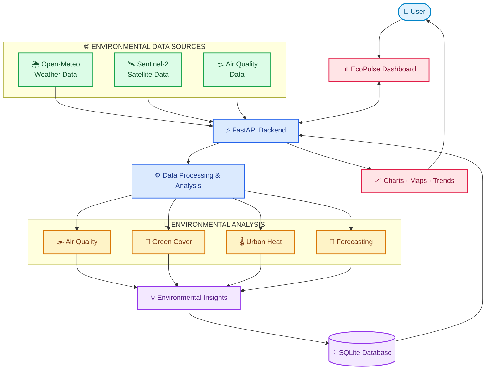

 

# 🌍 EcoPulse Mumbai

### Understand Your City. Protect Its Environment.

An environmental intelligence platform focused on Mumbai, combining air quality, weather and satellite observations to understand changing urban environmental conditions.

 

 

**ENVIRONMENTAL INTELLIGENCE FOR MUMBAI**

🌫️ Air Quality &nbsp; · &nbsp; 🌳 Green Cover &nbsp; · &nbsp; 🌡️ Urban Heat &nbsp; · &nbsp; 🌦️ Weather

---

## 🌱 Overview

EcoPulse Mumbai brings environmental data together in one platform to make it easier to understand the city's environmental conditions.

It combines weather and air-quality information with satellite-based environmental analysis to explore pollution, vegetation, urban heat and environmental trends across Mumbai.

The project focuses on **14 registered locations across Mumbai**, providing a city-specific view of environmental conditions.

## ✨ Key Features

| Feature | Description |
|---|---|
| 🌫️ Air Quality Monitoring | Track AQI and PM2.5 levels across selected locations |
| 🌦️ Weather Monitoring | View temperature, humidity and weather conditions |
| 🌳 Green Cover Analysis | Study vegetation using satellite observations |
| 🌡️ Urban Heat Analysis | Explore temperature patterns and urban heat conditions |
| 🔮 Environmental Forecast | View environmental forecasts up to 72 hours |
| ⚠️ Risk Analysis | Identify locations that may require environmental attention |
| 📊 Historical Trends | Understand changes in environmental conditions over time |
| 📍 Location-Based Dashboard | Explore information across 14 Mumbai locations |

## 🛰️ How It Works

## 🛠️ Technology Stack

| Category | Technologies |
|---|---|
| 💻 Language | Python 3.12 |
| ⚡ Backend | FastAPI, Uvicorn |
| ✅ Data Validation | Pydantic |
| 🔗 API Communication | HTTPX |
| 🗄️ Database | SQLite |
| ⚙️ Database Configuration | WAL Mode |
| 🌦️ Weather Data | Open-Meteo API |
| 🛰️ Satellite Data | Sentinel-2 |
| 🔬 Environmental Analysis | AQI, PM2.5, NDVI and urban heat analysis |

## 📍 Mumbai Coverage

EcoPulse is designed specifically for Mumbai, covering 14 registered locations.

| 📌 Area | 📌 Area | 📌 Area |
|---|---|---|
| Borivali | Kandivali | Malad |
| Andheri | Bandra | BKC |
| Dadar | Worli | Colaba |
| Sion | Kurla | Powai |
| Chembur | Mulund | — |

## 📊 Data & Analysis

EcoPulse combines multiple environmental data sources and analysis methods:

- 🌫️ **Air Quality:** AQI and PM2.5 monitoring.
- 🌦️ **Weather:** Temperature and humidity tracking.
- 🛰️ **Satellite Observations:** Satellite-based vegetation analysis.
- 🌳 **NDVI:** Understanding vegetation and green cover.
- 🌡️ **Urban Heat:** Exploring heat patterns across urban locations.
- 🔮 **Forecasting:** Environmental outlook for the next 72 hours.

Satellite observations and API-based measurements have their own update cycles; the platform does not imply that every dataset is real-time.

## 🔒 Reliability & Data Handling

- FastAPI backend with Pydantic validation.
- External API communication handled using HTTPX.
- SQLite persistence with WAL mode.
- Environmental information organized around registered Mumbai locations.
- Multiple environmental indicators combined to support location-based analysis.

## 🎯 Project Goal

Mumbai faces several interconnected environmental challenges, including air pollution, urban heat and changing green cover.

EcoPulse aims to make environmental information easier to access, understand and compare — helping people explore their city's environmental conditions through data.

---

### 🌍 See the Environment. Understand the Change.

💚 Built with Python &nbsp; · &nbsp; 📍 Focused on Mumbai &nbsp; · &nbsp; 📊 Driven by Environmental Data

